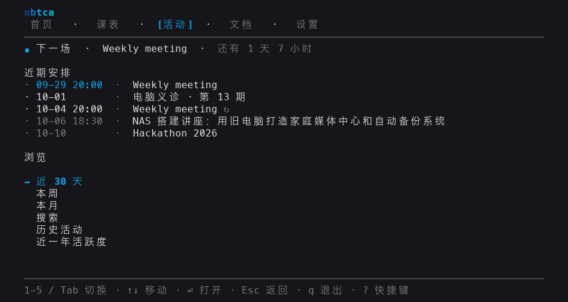

# NBTCA Prompt

Club events, the school calendar, your campus timetable, exams, grades, and the
NBTCA knowledge base in one terminal app. Cached public content and timetables
stay readable offline. Exam and grade queries require a connection.

[](https://www.npmjs.com/package/@nbtca/prompt)
[](LICENSE)



## Install

Requires Node.js 20.12 or newer.

```bash
npm install --global @nbtca/prompt
nbtca
```

Or try it without installing: `npx @nbtca/prompt`.

## Interactive mode

`nbtca` opens a full-screen client. Press `1`–`5` or `Tab` to switch tabs, and
`?` to list every key.

- **Home**: today's classes and the next club events.
- **Schedule**: the current term, week, and next break. Log in to the campus
  system to see your timetable and export it to any calendar app as `.ics`.
  Press `a` for personal exam arrangements or `g` for grades. Both are also
  available from the public Schedule menu before login.
- **Events**: a countdown to the next event, plus week and month views, search,
  history, and a one-year activity heatmap.
- **Docs**: read and search the knowledge base. It works even when GitHub is
  unreachable.
- **Settings**: language, icons, and colors.

The first load needs a network connection. Cached events and school calendars
remain available without an age limit; a failed refresh shows a cached-data notice.
Docs are available offline after reading them or loading them through search,
subject to the local cache's 4 MiB size limit.

## Commands

```text
nbtca events [--today|--week|--month] [--search=<q>] [--json]
nbtca schedule login|terms|export|logout
nbtca exams [--term=2025-2] [--json] [--one-shot]
nbtca exams --output=exams.ics [--term=2025-2]
nbtca grades [--term=2025-2] [--json] [--one-shot]
nbtca status [--watch]
nbtca docs
nbtca website|github|roadmap|repair [--open]
nbtca lang zh|en
nbtca update
```

`nbtca --help` lists every command and flag. Add `--plain` for output without
color.

Service checks wait up to 15 seconds by default. Use `--timeout=<ms>` to change
the limit. A timeout is shown separately from an offline result and appears as
`timedOut: true` in JSON. Failed public checks still return a nonzero exit code.

Exam and grade queries default to the current term. Use `--term` to select
another term, or press `s` in the interactive results. Press `r` to refresh
or `x` to log out.
Exam times remain unavailable until the school publishes them. Grades retain
the school's original numeric or textual result; Prompt does not calculate an
overall GPA. Records stay in memory and are not cached. `--json` writes them to
standard output, so keep redirected output private.

Use `nbtca exams --output=exams.ics` to export a private calendar for a calendar
app. Export requires a published time for every exam; it fails before writing if
any time is unavailable. Authentication stays in Prompt. The `nbtcal/academic`
module owns academic queries, parsing, calendar conversion and ICS serialization.

Prompt never stores your password. A saved campus session gets user-only file
permissions. See [SECURITY.md](SECURITY.md).

## Development

```bash
npm ci
npm run check
```

For unpublished changes shared with `nbtcal`, build and pack that repository,
then extract the candidate package into `node_modules/@nbtca/nbtcal` after
`npm ci`. Set `NBTCA_NBTCAL_TARBALL` to the tarball's absolute path when running
`npm run check` so the isolated package check uses the same candidate. `npm ci`
restores the published dependency. Publish `nbtcal` before updating Prompt's
registry dependency to the new API version.

## License

MIT
